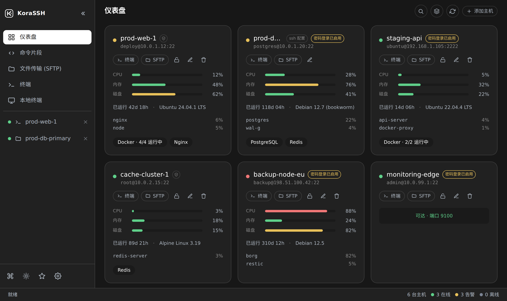

<div align="center">

# KoraSSH

本地优先、跨平台的现代 SSH 服务器监控仪表盘、多标签终端与 SFTP 客户端（桌面端 GUI + 终端版 TUI）

<a href="https://github.com/AnonyJcy/korassh">
  
</a>

[](https://github.com/AnonyJcy/korassh/releases)
[](LICENSE)
[]()
[]()

</div>

---

## 为什么做 KoraSSH

> 最初衍生自 [OmnySSH](https://github.com/timhartmann7/omnyssh) (Apache-2.0)，现已独立演进维护。

市面上的 SSH 客户端要么动辄几百 MB、带账号登录与云端遥测，要么界面陈旧、缺少顺手的日常交互。KoraSSH 坚持 **~5 MB 轻量体积、纯本地运行、无账号无遥测、只读兼容 `~/.ssh/config`** 的底线，在这个骨架上把主力 SSH 工具真正高频用得上的能力一次性补齐：

- **顺手的终端工作区**：左右/上下分屏、字号滚轮缩放、8 套终端配色、断线一键重连、克隆标签、URL 可点击、底部快捷命令条、关键字高亮、会话日志录制，以及一键打开本机 PowerShell / Bash / Zsh 的本地终端标签。
- **不仅能传、还能改的 SFTP**：双栏传输（整目录、拖拽、权限保留、取消）之外，支持直接在线编辑远程文本文件（`Ctrl+S` 保存）、目录筛选、隐藏文件开关、权限展示与 `chmod`，还可以在终端右侧直接拉出当前主机的折叠式 SFTP 侧边栏。
- **不留明文的安全存储与端到端同步**：主机与代理密码默认经 **AES-256-GCM** 自动密文落盘，支持在设置页开启 **Argon2id 主密码锁**；支持 `.korabak` 端到端加密备份导入导出，以及基于 **WebDAV / Git 仓库** 的无账号加密同步。
- **完整隧道与复杂网络支持**：同时支持本地转发（`-L`）、远程反向转发（`-R`）、动态 SOCKS5 转发（`-D`），以及 `ProxyJump` 跳板机与 **HTTP CONNECT / SOCKS5 前置代理**。
- **多平台免 Agent 仪表盘**：单窗口监控 Linux、macOS、FreeBSD 与远程 Windows 主机，支持分组、排序、拖拽排版、一键 SSH 密钥配置与安全恢复密码登录，以及录屏/直播隐私模式。
- **面向中文与 Windows 深度打磨**：简体中文 / English 双语切换、纯简体中文 Windows 安装向导、拦截 WebView2 `F5`/`Ctrl+R` 误刷新丢标签、失败主机一键唤醒重连，以及按需加载华为可商用的 **鸿蒙黑体（HarmonyOS Sans）**（默认系统字体零外网请求）。

---

## 下载与安装

### 直接下载（推荐）

前往 [**Releases 页面**](https://github.com/AnonyJcy/korassh/releases) 下载对应平台安装包（所有产物由 GitHub Actions 自动编译并附带 `SHA256SUMS` 校验）：

| 平台 | 桌面端 GUI | 终端版 TUI (`kora`) | 说明 |
|---|---|---|---|
| **Windows x86_64** | `KoraSSH-x86_64-setup.exe` / `KoraSSH-x86_64.zip` | `kora-x86_64-pc-windows-msvc.zip` | 安装版为纯简体中文向导；便携版需系统已装 WebView2 Runtime |
| **macOS (Apple Silicon)** | `KoraSSH-aarch64-apple-darwin.dmg` | `kora-aarch64-apple-darwin.tar.gz` | 适用于 M 系列芯片（首次打开若受拦截需在隐私与安全性中放行） |
| **macOS (Intel)** | `KoraSSH-x86_64-apple-darwin.dmg` | `kora-x86_64-apple-darwin.tar.gz` | 适用于 Intel 处理器 Mac |
| **Linux x86_64** | `KoraSSH-x86_64.AppImage` / `.deb` / `.rpm` | `kora-x86_64-unknown-linux-gnu.tar.gz` | 通用桌面包与终端包 |
| **Linux ARM64 / Termux** | — | `kora-aarch64-unknown-linux-musl.tar.gz` | musl 静态链接，直接运行于 Android Termux 与 ARM64 服务器 |

### 一键安装脚本（Linux / macOS / Git Bash）

```bash
# 安装桌面端（ARM64 Linux 或 Termux 会自动回退安装终端版 kora）
curl -fsSL https://raw.githubusercontent.com/AnonyJcy/korassh/main/install.sh | sh

# 仅安装终端版 kora
curl -fsSL https://raw.githubusercontent.com/AnonyJcy/korassh/main/install.sh | sh -s -- --tui

# 同时安装桌面端和终端版
curl -fsSL https://raw.githubusercontent.com/AnonyJcy/korassh/main/install.sh | sh -s -- --both
```

### 从源码构建

仅构建命令行终端版 `kora`（不依赖 Node.js 与 WebView 环境）：

```bash
cargo build --release --locked
# 产物位于 target/release/kora
```

桌面端构建步骤可参考 [.github/workflows/release.yml](.github/workflows/release.yml)。

---

## 配置目录与从 OmnySSH 平滑迁移

KoraSSH 使用独立的应用标识（`com.anonyjcy.korassh`）与配置目录，不会覆盖或干扰你原有的 OmnySSH 安装：

- **Windows**：`%APPDATA%\korassh\`
- **macOS**：`~/Library/Application Support/korassh/`
- **Linux**：`~/.config/korassh/`

**老用户自动迁移**：首次启动 KoraSSH 时，若检测到本机存在旧版 `omnyssh` 配置目录且 `korassh` 目录尚无数据，会自动无损复制 `hosts.toml`、`snippets.toml`、`config.toml`（不修改旧目录），并立即将旧版明文密码升级为 AES-256-GCM 密文存储。

### 终端版 (`kora`)


运行 `kora` 后，按 `a` 添加主机、`/` 搜索、`g` 按标签分组、`r` 强制刷新与重连、`Shift+K` 配置 SSH 密钥、`?` 查看帮助，完整文档见 `man kora`。

---

## 常见问题

- **macOS 连接局域网主机提示 `No route to host`**：前往「系统设置 → 隐私与安全性 → 本地网络」，勾选允许 KoraSSH 后重启。
- **群晖 Synology NAS 终端输入密码后提示 `Permission denied`**：Synology DSM 默认仅允许 `administrators` 群组账号开启 Shell，普通账号仍可使用 SFTP。
- **Windows 便携版无法打开窗口**：`KoraSSH-x86_64.zip` 不自带 WebView2 运行时；精简版系统请直接运行 `KoraSSH-x86_64-setup.exe`，安装程序会自动引导补齐运行环境。

---

## 开源协议与致谢

- 本项目最初衍生自 [timhartmann7/omnyssh](https://github.com/timhartmann7/omnyssh)（Apache-2.0），现已独立演进维护，完整保留原始 Git 提交历史与归属声明（详见 [NOTICE](NOTICE)）。
- 感谢原作者 **Tim Hartmann**（[@timhartmann7](https://github.com/timhartmann7)）打下的底层基础，以及社区 PR 贡献者 [@olcums](https://github.com/olcums)（#138）、[@sachin56](https://github.com/sachin56)（#152）与 [@alez0101](https://github.com/alez0101)（#162）。
- 源码基于 [Apache License 2.0](LICENSE) 开源；可选按需加载的鸿蒙黑体遵循华为 HarmonyOS Sans Fonts License 协议。

欢迎在 [GitHub Issues](https://github.com/AnonyJcy/korassh/issues) 提交反馈与建议。
